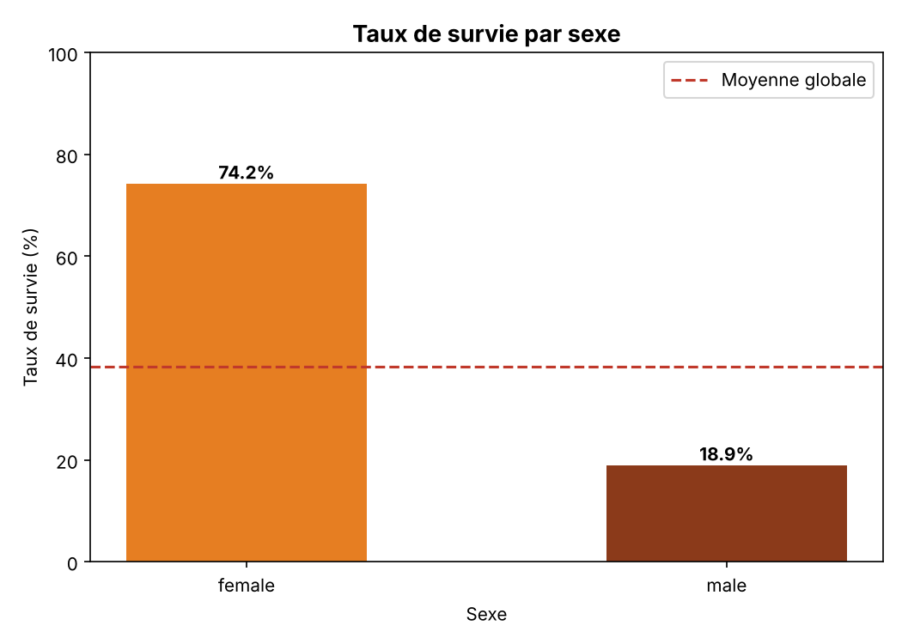
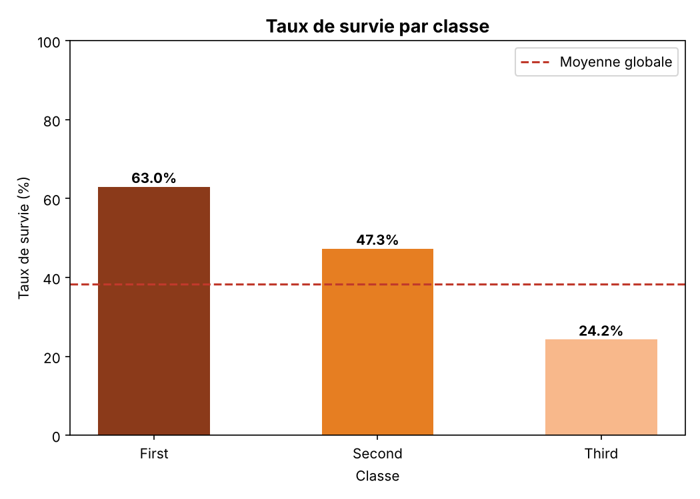
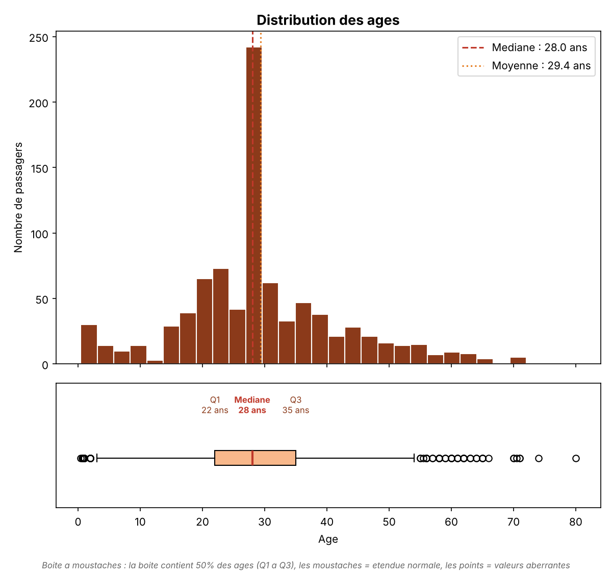

# Automated Excel reporting pipeline

Individual Python project by **Kenzo Brassart**, BSc Economics student at Université Paris 1 Panthéon-Sorbonne. It was built for the second-year Computer Science minor in 2026.

One command takes a raw CSV file (the Titanic passenger dataset, 891 records) and turns it into a **formatted 4-sheet Excel report**. It cleans the data, computes the statistics, draws the charts and writes the workbook, with no manual step in Excel.

The dataset is a classic teaching example. The point of the project is the pipeline: the same structure works for any recurring business report (portfolio positions, client lists, monthly figures).

## What the pipeline does

| Step | Module | Details |
|---|---|---|
| 1. Load and explore | `data_processing.py` | Reads the CSV and reports column types, record count and missing values |
| 2. Clean and enrich | `data_processing.py` | Fills missing ages with the median (more robust than the mean) and missing ports with the mode. Creates `FamilySize`, `IsAlone`, an encoded sex variable and age bands |
| 3. Analyse | `analysis.py` | Overall survival rate, rates by sex and by class, sex × class cross-tab, mean vs median age of survivors |
| 4. Visualise | `visualization.py` | 3 charts saved as PNG files: two bar charts with the overall average as a reference line, and an age histogram with a box plot |
| 5. Export | `excel_export.py` | Builds the formatted workbook with openpyxl |

## The Excel report

[Download the sample report](docs/rapport_titanic_exemple.xlsx)

- **Donnees**: the cleaned dataset (891 rows), with alternating row colours and frozen headers.
- **Indicateurs**: the key figures, colour-coded against thresholds.
- **Tableau croise**: a sex × class cross-tab plus **3 pivot tables**. Each pivot table shows the survival rate, the number of survivors and the headcount, with totals. One pivot table carries a note flagging that the *senior* group (22 people) is too small for reliable rates.
- **Graphiques**: the 3 charts embedded in the sheet.

<p>
  
  
  
</p>

## Key results

- 38.4% of passengers survived: 74.2% of women and 18.9% of men.
- Survival falls with class: 63.0% in first class, 47.3% in second, 24.2% in third.
- Women in first class: 96.8%. Men in third class: 13.5%.

## Run it

```bash
pip install -r requirements.txt
python main.py
```

The report is written to `output/rapport_titanic.xlsx` and opens automatically.

## Stack

Python · pandas · matplotlib · openpyxl

*Code comments and report labels are in French.*
